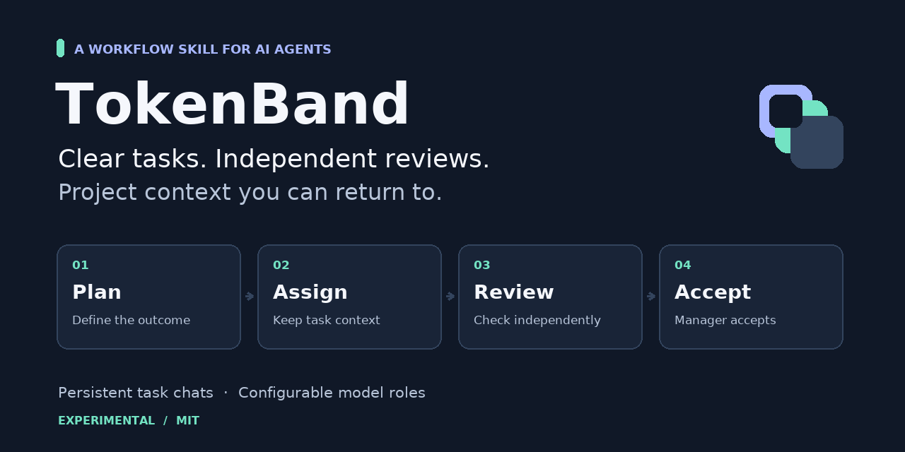
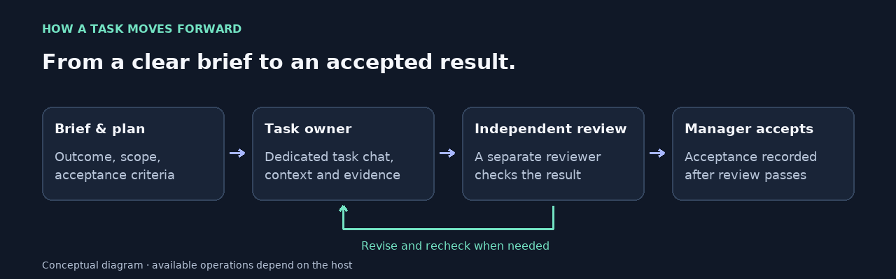

# TokenBand

Keep project work organised, resumable and independently checked. TokenBand gives AI agents a shared task list, a dedicated chat for each substantial task, and a clear process for reviewing and accepting results.

**[Download ZIP](https://github.com/drugoe/tokenband/raw/refs/heads/main/tokenband-0.6.13-skill.zip)** · [Quick start](docs/quickstart.md) · [Example](docs/example.md) · [Русский](README.ru.md)

**0.6.13** · **Experimental** · [**MIT**](LICENSE)

## What you get

- **One task list, a clear owner.** A single `TODO.md` in the project keeps task scope and status together. The manager coordinates work and accepts results.
- **Independent review by default.** A manager coordinates, a configured external executor produces work, and a separate reviewer checks it. Author completion is not acceptance.
- **Configurable role routing.** Assign work to configurable model roles to manage primary-model limits. Actual savings depend on the workload and setup.
- **Useful beyond code.** The same rules fit research, writing and content production when tasks are substantive enough to need a persistent chat.

Simple factual answers and meaning-preserving mechanical corrections stay direct. Even a small change to application, project, skill or process behavior requires its own persistent task chat. Other substantial work also uses a task chat and the applicable independent review.

## Latest update

Version 0.6.13 includes visible milestone results, a shorter setup conversation, cleanup fixes and Kimi Code discovery notes. For already authorized reversible local work, the manager continues after at most 15 minutes of uncertainty without separate project activation or terminal/cleanup proof, using a separate working copy when earlier writes remain possible and reconciling changes before integration. This does not guarantee process termination, physical isolation or real-time wakeup, and never removes Stop, actual denials, consent or external-effect gates. See [release notes](docs/releases/0.6.13.md).

## How it fits

*Diagram: brief → scoped task chat → execution → independent review → manager acceptance.*

## Host requirements

TokenBand is an instruction package, not a standalone application. It requires an AI agent host that supports loading a `SKILL.md` from a skills directory and can map its controls to the workflow: file access, persistent session creation and resume, session titling, and permission or reporting hooks. Core routing principles do not depend on a particular model family. The package uses plain Markdown instructions, references, templates and an optional Python worker; no bundled credentials or automatic installers are included.

Model choice and application support are separate questions. Check the [host-specific notes](docs/quickstart.md#host-compatibility) before relying on the full task lifecycle. Copying files alone does not start tasks.

## Install and configure

See [docs/quickstart.md](docs/quickstart.md) for download, SHA-256 checksum, placement and first-run checks. The ZIP contains the same source skill files; configuration and external provider access are separate setup steps. No private paths, accounts or model assignments ship with the package.

## FAQ

**Does it start automatically?** No. Installing the skill does not create schedules, daemons or tasks. Work begins when you ask the agent to apply the workflow to a project.

**Are external model costs included?** No. The selected execution routes may need separate API access or provider accounts. Model usage costs and permissions remain yours to manage.

**Where do I report issues?** Open an [issue](https://github.com/drugoe/tokenband/issues) with the host application, package version, expected result and what happened. Remove secrets and private project data from attachments.

## Source and license

The skill source is at [skill/tokenband/SKILL.md](skill/tokenband/SKILL.md). Licensed under [MIT](LICENSE).