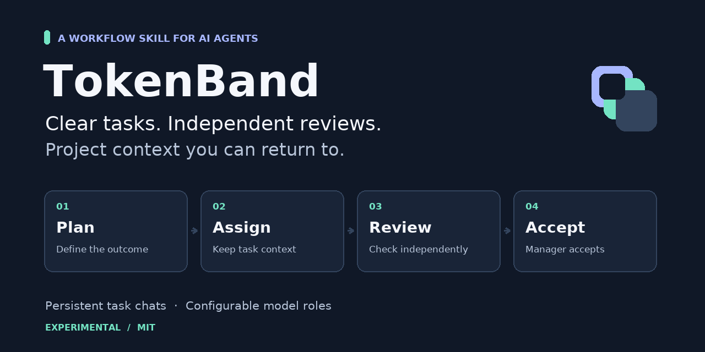
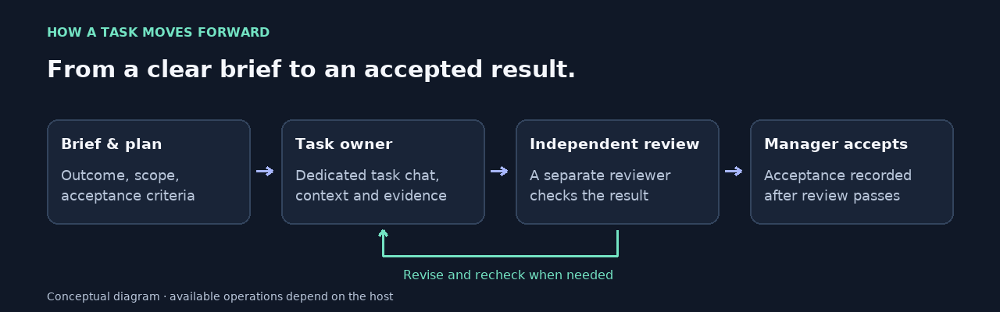

# TokenBand

Организуйте работу ИИ-агентов над проектом: единый список задач, отдельные чаты с сохранённым контекстом и независимая проверка результатов перед приёмкой.

**[Скачать ZIP](https://github.com/drugoe/tokenband/raw/refs/heads/main/tokenband-0.6.11-skill.zip)** · [Быстрый старт](docs/quickstart.ru.md) · [Пример](docs/example.ru.md) · [English](README.md)

**0.6.11** · **Экспериментальная версия** · [**MIT**](LICENSE)

## Что вы получаете

- **Единый список задач и понятная ответственность.** `TODO.md` в папке проекта хранит постановки и статусы. Менеджер координирует работу и принимает результаты.
- **Независимая проверка.** Настроенный исполнитель выполняет задачу, отдельный проверяющий сверяет результат. Сообщение автора «готово» ещё не означает приёмку.
- **Распределение работы между моделями.** Настраиваемые роли помогают управлять расходом лимитов основной модели. Фактическая экономия зависит от задач и настройки.
- **Работа с разными типами задач.** Разработка, исследования, тексты и подготовка материалов могут использовать один подход к контексту и проверке.

Простые вопросы и механические исправления выполняются напрямую. Отдельные чаты нужны для содержательных проектных задач; изменение поведения приложения требует чата задачи даже при небольшой правке.

## Что нового

В 0.6.11 вошли показ содержательных результатов пользователю, удобный диалог настройки, исправления cleanup и руководство по обнаружению скилла в Kimi Code. Уже порученная обратимая локальная работа продолжается после не более 15 минут неопределённости без отдельного включения политики в проекте и доказанного terminal/cleanup; при возможности прежних записей используется рабочая копия, изменения сверяет менеджер. Это не гарантирует остановку процесса, физическую изоляцию или пробуждение менеджера и не отменяет Stop, реальные отказы, разрешения и ограничения внешних действий. [Описание выпуска](docs/releases/0.6.11.md).

## Как это работает

*Иллюстрация процесса. Это схема, а не скриншот приложения. В [вымышленном примере](docs/example.ru.md) показано, как проверка обнаруживает пропущенную часть задания.*

## Какая среда нужна

TokenBand — пакет инструкций, справочных материалов и шаблонов. Приложение ИИ-агента должно уметь загружать `SKILL.md`, работать с файлами проекта, создавать, именовать и продолжать постоянные чаты задач, а также корректно передавать сведения о разрешениях, остановке и результатах.

Основные правила не зависят от семейства моделей. Поддержка конкретного приложения — отдельный вопрос: перед использованием полного процесса проверьте [совместимость среды](docs/quickstart.ru.md#совместимость-среды). Копирование файлов само по себе не запускает задачи.

## Установка и первый запуск

В [быстром старте](docs/quickstart.ru.md) описаны скачивание, контрольная сумма, размещение скилла и проверка настройки ролей. ZIP содержит исходный пакет скилла. Выбор моделей и подключение нужных маршрутов выполняются отдельно. В пакет не входят приватные пути, аккаунты или назначения моделей.

## Частые вопросы

**Запустится ли что-нибудь после установки?** Нет. Копирование скилла не создаёт задач, расписаний или фоновых служб. Для начала попросите агента применить TokenBand к проекту.

**Включена ли оплата моделей?** Нет. Выбранным маршрутам могут понадобиться отдельные аккаунты или API-доступ. Их стоимость и разрешения вы контролируете самостоятельно.

**Как сообщить о проблеме?** Создайте [issue](https://github.com/drugoe/tokenband/issues): укажите приложение, версию пакета, ожидаемый результат и что произошло. Удалите секреты и приватные данные проекта из вложений.

## Исходники и лицензия

Основные инструкции: [skill/tokenband/SKILL.md](skill/tokenband/SKILL.md). Лицензия — [MIT](LICENSE).
